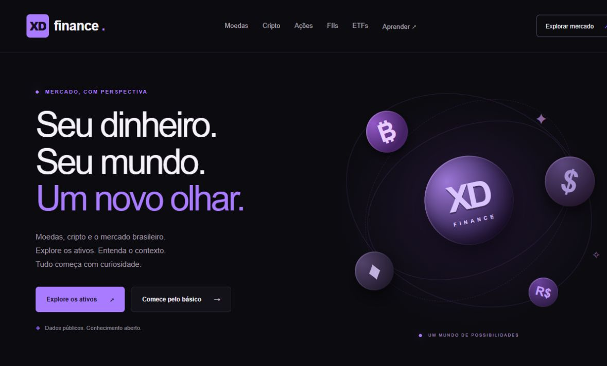

# XD Finance

### Seu dinheiro. Seu mundo. Um novo olhar.

Portal educativo de moedas, criptomoedas e mercado brasileiro, com uma experiência **dark em roxo**. Desenvolvido com **Next.js, React e TypeScript**, integrado à **brapi** e preparado para publicação na **Vercel**.

**Criação: David Xavier · XD Plans**



## O projeto

O XD Finance reúne exploração de ativos e conteúdo educativo em uma landing page com páginas dedicadas. A proposta é ajudar o visitante a conhecer os símbolos, entender os conceitos e conferir a origem dos dados.

## Funcionalidades

- Landing page responsiva com identidade visual própria.
- Páginas de moedas, criptomoedas, ações, FIIs e ETFs.
- Catálogo público da B3 com logos e dados básicos quando disponíveis.
- Busca por nome ou símbolo, filtros, ordenação e paginação.
- Favoritos persistidos no navegador, sem necessidade de cadastro.
- Páginas de detalhes com cotação básica e resumo empresarial quando autorizado e disponível.
- Guias introdutórios sobre câmbio, ativos e variação de preços.
- Conversor educativo com taxas fictícias, explicitamente identificado.
- Página de fontes, cobertura e créditos.

## Tecnologias

| Camada           | Tecnologia                    |
| ---------------- | ----------------------------- |
| Interface        | React 19 e CSS responsivo     |
| Aplicação        | Next.js 15 · App Router       |
| Linguagem        | TypeScript                    |
| Dados de mercado | brapi · consultas no servidor |
| Publicação       | Compatível com Vercel         |

## Dados gratuitos e cobertura

| Recurso                                             | Nesta versão                                                    |
| --------------------------------------------------- | --------------------------------------------------------------- |
| Ações, FIIs e ETFs                                  | Catálogo público, logos e dados básicos da B3                   |
| PETR4, VALE3, MGLU3 e ITUB4                         | Cotação sandbox sem chave                                       |
| Resumo de empresas                                  | Integração do perfil incluído no Free, com fallback editorial   |
| Outros ativos da B3                                 | Cotação básica autenticada quando a chave for configurada       |
| Moedas e cripto                                     | Catálogo educativo; cotação atual da brapi exige Startup ou Pro |
| Conversor                                           | Simulação com taxas fixas fictícias                             |
| Dividendos, fundamentos avançados e FIIs detalhados | Fora do escopo desta versão                                     |

A listagem pública fornece preços de fechamento; o sandbox pode fornecer uma cotação com outra data. Cada página identifica sua fonte. Se a API estiver indisponível, o catálogo continua acessível sem inventar valores.

O Free informa 15.000 requisições por ciclo mensal, uma requisição simultânea, uma ação por chamada e histórico de até três meses com intervalo diário. A frequência informada é de 30 minutos. As condições podem mudar: consulte os [planos oficiais](https://brapi.dev/pricing) e a [documentação](https://brapi.dev/docs).

Veja a pesquisa e as verificações em [docs/brapi-free.md](docs/brapi-free.md).

## Executar localmente

Requisito: **Node.js 20.9 ou superior**.

```bash
git clone https://github.com/davidxavierxdplanschat/xd-finance.git
cd xd-finance
npm ci
npm run dev
```

Abra [localhost:3000](http://localhost:3000).

O projeto funciona sem chave utilizando a lista pública e as ações sandbox. Para recursos autenticados, copie `.env.example` para `.env.local`:

```dotenv
BRAPI_API_KEY=
NEXT_PUBLIC_SITE_URL=http://localhost:3000
```

Configure sua chave somente em `BRAPI_API_KEY`. A chave é lida no servidor e nunca deve receber prefixo `NEXT_PUBLIC_`, ser incluída em URLs ou enviada ao Git.

## Comandos

| Comando                | Finalidade                                    |
| ---------------------- | --------------------------------------------- |
| `npm run dev`          | Desenvolvimento local                         |
| `npm run build`        | Compilação de produção e verificação de tipos |
| `npm run start`        | Servir a compilação de produção               |
| `npm run typecheck`    | Verificação TypeScript                        |
| `npm run format`       | Formatar o código e a documentação            |
| `npm run format:check` | Conferir a formatação                         |

## Publicar na Vercel

1. Importe o repositório `davidxavierxdplanschat/xd-finance`.
2. Selecione o preset **Next.js** e mantenha a pasta raiz do repositório.
3. Configure `NEXT_PUBLIC_SITE_URL` com o domínio HTTPS de produção, sem barra final.
4. Configure `BRAPI_API_KEY` no painel da Vercel quando precisar de consultas autenticadas.
5. Use as configurações padrão e o comando `npm run build`.

Não é necessário um `vercel.json` para esta configuração. Fornecer a chave não libera recursos de planos pagos. O acesso deve ser validado com a cobertura da conta.

## SEO e desempenho

- HTML renderizado no servidor e páginas principais geradas antecipadamente.
- Títulos e descrições por página, URLs canônicas e idioma `pt-BR`.
- Sitemap para o catálogo e guias, arquivo robots e imagem social.
- Dados estruturados com autoria e créditos.
- Cache de 30 minutos nas consultas de mercado e 24 horas no perfil empresarial.
- Catálogo paginado e conteúdo reduzido enviado ao navegador.
- Interface responsiva, navegação por teclado e suporte a movimento reduzido.

Em localhost o site utiliza `noindex` e bloqueia rastreamento. O endereço HTTPS configurado habilita a indexação. Restrinja previews na Vercel para evitar cópias indexadas. Após publicar, verifique o domínio no Google Search Console e envie `/sitemap.xml`. Esses recursos não garantem inclusão ou posicionamento no Google.

## Estrutura

```text
app/          Páginas, metadados e estilos
components/   Explorador de ativos, ícones e conversor
lib/          Catálogo editorial e integração brapi no servidor
docs/         Prévia visual e análise da cobertura gratuita
```

## Fontes e créditos

- **Projeto:** XD Finance
- **Concepção e criação:** David Xavier
- **Créditos:** XD Plans
- **Dados de mercado:** [brapi.dev](https://brapi.dev/)
- **Ícones de cripto:** [cryptocurrency-icons](https://github.com/spothq/cryptocurrency-icons)

Conteúdo informativo e educativo. Não constitui recomendação de investimento. A conversão demonstrativa não representa uma cotação atual. Marcas e logos pertencem aos respectivos titulares.
